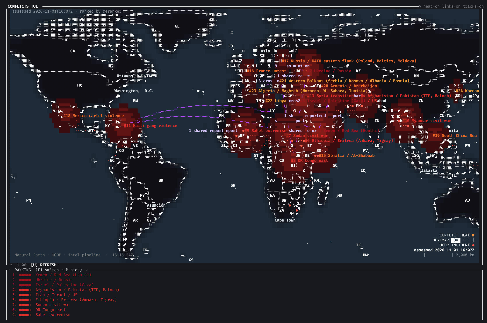

# World-conflict map / TUI

[](LICENSE)

A self-contained curses app: a braille-rendered world map (port of
[Terrascope](https://github.com/a-shygun/Terrascope)'s rendering) showing the
world-conflict intel pipeline — ranked conflicts, a red heat overlay, UCDP
event dots, correlation lines — plus CoT multicast tracks.

The intel pipeline (gather → match →
rerank → summarize → brief) is vendored under `conflictmap/intel/`,
map data ships in `data/naturalearth/`, and everything else is stdlib.

## Screenshots


*World view — conflict heat, ranked diamonds, UCDP incidents, correlation links (Haiti↔Sudan arcs visible), ranking panel at the bottom.*


*Close-up over Europe and the Middle East — per-conflict labels, shared-report links, UCDP dots.*

## Install

```bash
git clone https://github.com/paoloo/conflictmap
cd conflictmap
python3 -m venv .venv && source .venv/bin/activate   # or use conda
pip install -r requirements.txt
```

Python 3.11+ (3.12 tested). curses is stdlib on macOS/Linux; on Windows use
`windows-curses`.

## Run

```bash
python -m conflictmap          # or: make run
```

First launch renders the world immediately. The status line says
`no ranked run yet — press U to refresh` until the first intel run finishes.

## The models

Ranking and summarization run as local llama.cpp/Ollama servers, launched on
demand and stopped after the run:

| Stage | Model (default) | Server | Notes |
|---|---|---|---|
| Rank (reranker) | `gpustack/bge-reranker-v2-m3-GGUF:Q4_K_M` | `llama-server` (llama.cpp) on `127.0.0.1:8091` | scores candidate articles per conflict; needed for `ranked_by = reranker` |
| Summarize | `huggingface.co/TeskesLab/Liberation-Qwen3-8B:Q4_K_M` | Ollama on `127.0.0.1:11434` | writes per-conflict level/trend/summary + the world brief |

- **llama.cpp**: `brew install llama.cpp` (macOS) or build with cmake; the app
  finds the `llama-server` binary on `PATH`.
- **Ollama**: `brew install ollama` / `ollama serve`; it pulls the model from
  Hugging Face on first use (several GB, one time).
- Both can run on another machine: set `ollama_host` in `config.toml`, and/or
  start the reranker once yourself (`llama-server -hf
  gpustack/bge-reranker-v2-m3-GGUF:Q4_K_M --port 8091 --reranking`) — the app
  reuses an already-healthy server on that port and never stops one it didn't
  start.
- **No models at all?** Set `[intel] summarize = false` in `config.toml`:
  refresh then gathers and ranks by recency only (`ranked_by = recency`) and
  still draws diamonds, heat, events and links.

## Data

- `data/naturalearth/ne_50m_admin_0_countries.geojson` — country polygons,
  labels, capitals (bundled, Natural Earth public domain).
- `data/naturalearth/ne_10m_populated_places_simple.geojson` — city labels.
- `data/newsgather.db` — created on first refresh; gathers RSS feeds + the
  UCDP candidate events CSV (network needed only for refresh).
- `data/nodes.db` — starter node store; the correlation layer can tie nodes
  and tracks to nearby conflicts. Delete the `home` row and add your own.

## Keys

| Key | Action |
|---|---|
| `h j k l` / arrows | pan (vim-style; `l` is taken by the links toggle, use `i`) |
| `+` / `-` or mouse wheel | zoom at pointer |
| `a` | aggression overlay (diamonds + heat + UCDP dots) on/off |
| `l` | correlation lines on/off |
| `t` | tracks & nodes on/off |
| `p` | bottom panel (RANKING / INFO / BRIEF) on/off |
| `F1` | cycle panel tab |
| `U` or click `[U] REFRESH` | run the full pipeline in-process (gather → rank → summarize), progress on the map |
| `r` | reset view |
| `q` | quit |

Click a diamond for its INFO panel; the BRIEF tab shows the world summary the
summarizer wrote.

## Config

`config.toml` (same `[intel]`/`[aggression]`/`[links]`/`[cot]` schema as the
Qt sibling project; relative paths resolve against this directory, never the
CWD). Sensible single-file defaults; `db = "data/newsgather.db"`.

## Layout

```
conflictmap/
  main.py            entry point, wiring
  app/               data loading, refresh worker, CoT adapter, config
  core/              map maths, layer base, world state (ported from Terrascope)
  ui/                curses drawing: map box, colors, layout
  layers/            basemap, conflicts (heat+diamonds), links, tracks
  intel/             vendored pipeline: gather, classify, correlate, llm, reranker
  cot/               vendored CoT multicast listener/parser
data/                bundled Natural Earth GeoJSON, starter nodes.db,
                     runtime newsgather.db (created on first refresh)
```

## License

MIT — see [LICENSE](LICENSE). The vendored `intel/` and `cot/` packages come
from the sibling mini-ATAK project; the Terrascope-derived rendering code
(`core/`, `ui/`, parts of `mapdata.py`) is adapted from
[Terrascope](https://github.com/a-shygun/Terrascope) (MIT).
